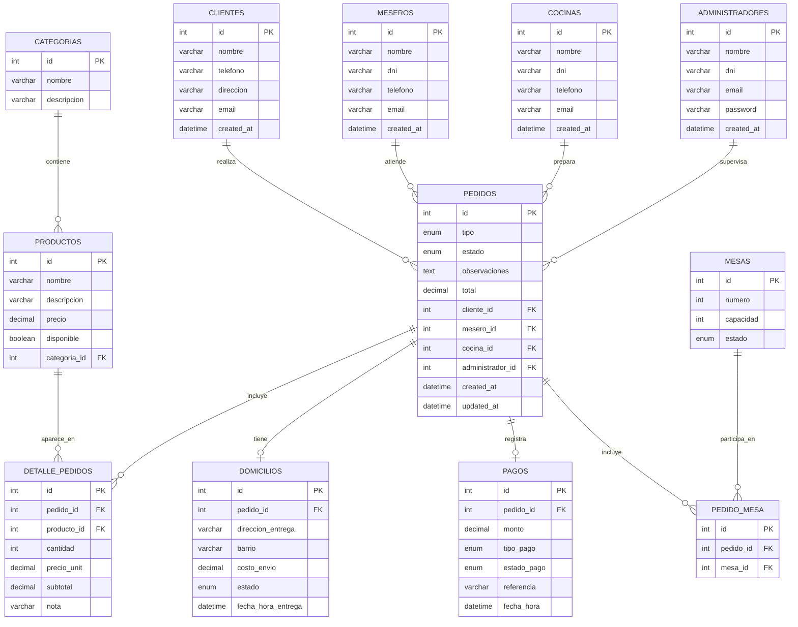

# Diagrama relacional del proyecto

## Cómo editarlo

1. Abre este archivo en VS Code.
2. Haz clic en la vista previa Markdown (Ctrl + Shift + V).
3. Si quieres cambiar algo, edita el bloque Mermaid directamente.
4. Puedes volver a abrir la vista previa para ver el resultado.

> Esto permite que lo puedas modificar antes de mostrárselo al profesor sin perder la visualización del diagrama.
